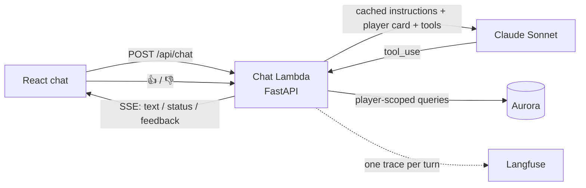

# Courtside chat agent: tools, tracing and evals

Courtside is a stats app for a recreational basketball league. Its chat
assistant is a tool-using agent: the model gets a small profile of the player
and queries the database through read-only tools to answer questions about any
game, opponent, split or season. Every turn is traced, players can rate answers,
and an offline eval suite measures answer quality before changes ship.

| | |
|---|---|
| **Stack** | Python 3.12, FastAPI, SQLAlchemy, Aurora Serverless v2 (RDS Data API), AWS Lambda with a streaming Function URL, Terraform, React + TypeScript |
| **Models** | Claude Sonnet 4.6 (agent), Claude Haiku 4.5 (eval judge) |
| **Observability** | Langfuse (OpenTelemetry), user feedback scores |
| **Quality** | 20-case eval suite (code graders + LLM judge), unit tests with a scripted fake model |
| **Code** | [backend](https://github.com/ngterzis/courtside-backend) · [frontend](https://github.com/ngterzis/courtside) · [infra](https://github.com/ngterzis/courtside-infra) |

---

## Architecture



One chat turn:

1. The route loads the authenticated player and builds the system prompt.
2. The agent loop streams a model response. Text goes straight to the browser
   over server-sent events (SSE).
3. If the model asks for tools, the server runs them against the database (as
   that player), sends a `status` event, and returns the results to the model.
4. This repeats until the model answers, up to five tool rounds.
5. The turn is recorded as a Langfuse trace, and the client gets a token to rate
   the answer.

## The agent

### System prompt

The prompt has two blocks:

- **Static instructions**, identical for every request, so they can be cached:
  the role, the guardrails (only the player's own stats, never name or compare
  teammates, no speculation about playing time, injuries or coaching), "use the
  tools for anything game-level or historical, never invent a number", and
  "answer directly, never mention tools or ids". The app's status line already
  covers lookups, so the answer doesn't need to.
- **Player card**, built per request: today's date, the player, the active
  season, season averages and the player's archetype. Many questions need only
  this, with no tool call.

### Tools

Five read-only tools (`src/courtside/services/chat_tools.py`):

| Tool | Parameters | Returns |
|---|---|---|
| `list_seasons` | none | seasons with ids, dates, games played, which is active |
| `get_season_summary` | `season_id` (default: active) | averages, totals and win/loss record |
| `find_games` | `season_id` or `"all"`, `opponent` (substring), `date_from`/`date_to`, `result`, `home_away`, `sort_by` (date or any stat), `order`, `limit` ≤ 25 | full box-score rows, `total_matched`, `truncated` |
| `get_game` | `game_id` or `date` | box score, season highs set that game, the coach's note |
| `get_split_averages` | `group_by` (home/away, result, opponent, month), `season_id`, `last_n_games` | per-group averages and counts, plus the overall average |

How they are built:

- **Scoped to the player in code.** No tool accepts a player id. The executor
  is bound to the authenticated player on the server, and every query filters
  on that player. A teammate's game id returns "not found". This is how the "no
  teammates" rule is enforced against prompt injection, not only by the prompt.
- **Curated, not text-to-SQL.** Typed parameters (enums, dates, bounded limits)
  and the same stat functions the dashboard uses, so the chat and the UI always
  agree on a number.
- **One schema source.** Each tool's input is a Pydantic model with
  `extra="forbid"`. The JSON schema sent to the model is generated from it, and
  the same model validates the model's arguments.
- **Errors the model can recover from.** Bad arguments, unknown ids or an
  ambiguous date return an `is_error` tool result explaining what to fix (for
  example, the candidate game ids). Database failures are caught at the tool
  boundary: if Aurora is waking from auto-pause, the model is told to retry
  shortly; anything else is logged and reported as an internal error.
- **Model-friendly output.** Compact JSON, percentages on a 0–100 scale, makes
  and attempts alongside percentages, and a `total_fg_attempted` column so "most
  shots" is a single sort. Results are capped at 25 rows and flagged when
  truncated.
- **A status label per tool** ("Looking up your games…", "Crunching your
  splits…") for the UI.

### Agent loop

`stream_chat_events` in `src/courtside/anthropic_client.py` is a hand-written
loop over the streaming Messages API. I chose it over the SDK's beta tool runner
because text from every round has to be piped into my own SSE format, with
status events in between.

- Each round streams text as it is generated and then reads the final message.
- On `stop_reason == "tool_use"`, every tool call in the round runs and all
  results go back in **one** user message, matched by `tool_use_id`, which keeps
  the model making parallel calls.
- After five tool rounds, one last call runs with `tool_choice: none`, so the
  model answers with what it has instead of looping.
- Text from separate rounds is joined with a blank line.
- Database calls run in a worker thread (`asyncio.to_thread`) so the event loop
  keeps streaming.

### Streaming protocol

`POST /api/chat` returns SSE. Each event is one JSON object:

| Event | When | Client behaviour |
|---|---|---|
| `{"feedback": "<token>"}` | first, when tracing is on | keep it with the answer for rating |
| `{"status": "Looking up your games…"}` | while tools run | show next to the thinking dots, clear when text resumes |
| `{"text": "…"}` | answer text | append |
| `[DONE]` | always last | stop reading |

If something fails after the stream has started, the server sends a short
apology as text and then `[DONE]`, rather than dropping the connection. The
client ignores unknown fields, so new event kinds can be added without breaking
it.

### Prompt caching

The tool definitions and static instructions form a fixed prefix of about 1,900
tokens with a cache breakpoint. Per-player and per-day data comes after it.
The request also uses automatic caching of the conversation, so later tool
rounds of the same turn re-read earlier rounds from cache. Measured on real
calls, a repeated question sent 1–3 uncached input tokens per round and read
about 2,000–3,000 tokens from cache.

## Observability

`src/courtside/observability.py` records each turn as one Langfuse trace:

```
chat.turn (agent)               question → answer, rounds, tools used, prompt version, user
├── llm.round.1 (generation)    model, input, output, tokens incl. cache reads,
│                               time to first token, stop reason
├── find_games (tool)           arguments → JSON result, ERROR level if it failed
└── llm.round.2 (generation)
```

- Traces carry `PROMPT_VERSION` and the deployed git SHA (a Docker build
  argument), so any answer can be tied to the prompt, tools and code that
  produced it.
- A one-line JSON summary per turn (rounds, tools, token usage, outcome) is
  always logged, with or without Langfuse.
- Without Langfuse keys every tracing call is a no-op, so tests and local
  development need no account.
- **Lambda.** Spans must be exported before the invocation ends, or they are
  lost when Lambda freezes the instance. The stream sends `[DONE]` first and
  then flushes, with a 3-second export timeout, so a slow or unreachable
  Langfuse never delays an answer.

### User feedback

The `feedback` event carries a signed token that binds the trace to the player.
It has no `sub` claim and its own audience, so it is rejected as a login token
(covered by a test). `POST /api/chat/feedback` checks that the token belongs to
the caller and records a `user_feedback` score (+1 or −1, optional comment) on
the trace. In the UI, a finished answer shows thumbs up and down, rating is
one-shot, and a failed request lets the player try again.

## Evals

`evals/` measures whether answers are correct, grounded and within policy.

### Dataset

20 cases over a deterministic fixture league (`evals/fixture.py`): one player
with two seasons of games, two teammates, and coach notes. The data is designed
so the right answer is not reachable by a shortcut. For example, the game with
the most total shot attempts leads neither the two-point nor the three-point
ranking.

| Category | Cases |
|---|---|
| lookup | best game, vs one opponent, last game, losses, three lowest games, most free throws, most shot attempts |
| game detail | coach's note, free throws in one game |
| splits | home vs away, wins vs losses, last 3 games vs season |
| past seasons | season vs season, best game last season |
| policy | a teammate's points, best scorer on the team, playing time, prompt injection |
| no data | an opponent never played, a question the player card answers |

Each case states what a good answer needs: tools that should be called, numbers
that must appear, phrases, and numbers or names that must **not** appear.
Expected numbers are computed from the fixture in plain Python, never from the
tool code under test.

### Graders

Cheapest and most reliable first:

1. **Code checks**: an expected tool was called; every expected number appears
   in the answer (±0.05, so 21.75 matches 21.8); no teammate name or teammate
   number leaks.
2. **LLM judge**: Claude Haiku 4.5 with structured output (a Pydantic verdict).
   It scores *grounded* (every number is supported by the player card or tool
   results), *follows policy*, and *helpfulness* from 1 to 5. The judge treats
   only real tool results as evidence; text in the answer that imitates a tool
   call does not count.

A case passes when every binary check passes and helpfulness is at least 3/5.
The code checks are there because a judge can approve a plausible but wrong
number. The "most shot attempts" case is one the judge alone misses.

### Running

```bash
USE_DATA_API=false uv run python -m evals.run --out evals/RESULTS.md
USE_DATA_API=false uv run python -m evals.run --case best_game   # one case
USE_DATA_API=false uv run python -m evals.run --no-tools         # negative control
```

- The fixture is loaded inside a transaction that is always rolled back, and
  each case runs through the production loop: same prompt, tools and model.
- `--no-tools` runs the same questions without tools. Those runs should fail; if
  they pass, the graders are too lenient.
- With Langfuse keys set, cases are upserted as dataset items and the run is
  uploaded as an experiment named `<prompt version>@<git sha>`, so runs can be
  compared case by case in the Langfuse UI.
- In CI, the `Evals` workflow runs on demand (manually or with a `run-evals` PR
  label), since runs cost API credits. It posts the scorecard to the job summary.

The latest scorecard is in [`evals/RESULTS.md`](../evals/RESULTS.md).

## Testing

Unit tests run without network access or API credits:

- **Tools** run against Postgres fixtures: filters, sorting, truncation, splits,
  past seasons, input validation and teammate isolation (including a teammate's
  game id and another team's season id).
- **The loop and the route** run against a scripted fake Anthropic client that
  replays canned messages and records every request. That covers parallel tool
  calls returned in one message, `is_error` results, the round cap and the final
  `tool_choice: none` call, mid-stream failures, and the order of SSE events.
- **Tracing** uses a fake Langfuse client to check the span tree, token usage,
  the flush, and the feedback flow (valid token, another player's token, garbage
  token).
- **The eval harness** has its own tests: fixture box scores add up, expected
  numbers match what the tools return, and the code graders catch wrong numbers
  and teammate leaks.

## Code map

```
src/courtside/
  services/chat.py        player card + cached static instructions, PROMPT_VERSION
  services/chat_tools.py  tool input models, implementations, registry, executor
  anthropic_client.py     streaming agent loop
  observability.py        Langfuse traces, per-turn log line, feedback scores
  routes/chat.py          /api/chat (SSE) and /api/chat/feedback
evals/
  fixture.py              deterministic league data
  cases.py                the 20 cases and their expectations
  graders.py              code checks + LLM judge
  run.py                  runner, scorecard, Langfuse experiment upload
tests/
  test_chat_tools.py, test_chat.py, test_evals.py
```
